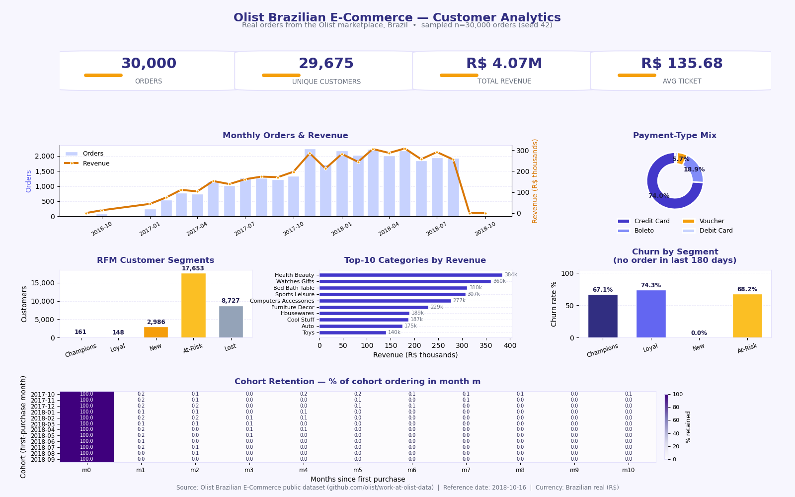

# Olist Brazilian E-Commerce Customer Analytics

A multi-panel customer analytics dashboard built on **real order data** from the
Olist marketplace in Brazil (2016–2018), with KPIs, RFM segmentation, a monthly
orders & revenue trend, payment-type mix, top product categories, a cohort
retention heatmap, and churn by segment.



> Want to rebuild this in Power BI? See **[powerbi-guide.md](powerbi-guide.md)** —
> a step-by-step Arabic guide (fastest path: paste-ready Python visuals, plus a
> native DAX alternative) that reproduces this dashboard in ~15 minutes.
> Paste **`powerbi-page1-overview.py`** (KPIs + trends) and
> **`powerbi-page2-details.py`** (RFM + cohorts + categories) into two Python
> visuals. The `dashboard.png` above is the visual reference for the target layout.

## Design

Distinct indigo (**#4338CA**) + amber (**#F59E0B**) palette on a light
background: rounded KPI cards, asymmetric panel spans, subtle grids, and a
purple cohort heatmap — the same styling is applied to the Power BI scripts.

## Dataset

**Olist Brazilian E-Commerce** — public dataset published by Olist, mirrored at
<https://github.com/olist/work-at-olist-data> (originally released on Kaggle).
It contains real orders from the Olist marketplace in Brazil, 2016–2018.

## Sampling (deterministic)

The full dataset (~48 MB, 99,441 orders) is sampled to keep the project light:

- **30,000 orders** drawn with `pandas.DataFrame.sample(n=30000, random_state=42)`
- `customers.csv`: only customer rows belonging to the sampled orders
- `order_items.csv` / `order_payments.csv`: only rows belonging to the sampled orders
- `products.csv`: only products appearing in the sampled items
- `product_category_name_translation.csv`: kept whole (71 rows)

Same procedure in `download_data.py` (downloads the 6 source CSVs from
`https://raw.githubusercontent.com/olist/work-at-olist-data/master/datasets/`
then samples) and in the sampling script used to build `data/`.

### Tables after sampling

| File | Rows | Cols | Columns |
|---|---|---|---|
| `orders.csv` | 30,000 | 8 | order_id, customer_id, order_status, order_purchase_timestamp, order_approved_at, order_delivered_carrier_date, order_delivered_customer_date, order_estimated_delivery_date |
| `customers.csv` | 30,000 | 5 | customer_id, customer_unique_id, customer_zip_code_prefix, customer_city, customer_state |
| `order_items.csv` | 34,017 | 7 | order_id, order_item_id, product_id, seller_id, shipping_limit_date, price, freight_value |
| `order_payments.csv` | 31,385 | 5 | order_id, payment_sequential, payment_type, payment_installments, payment_value |
| `products.csv` | 15,204 | 9 | product_id, product_category_name, product_name_lenght, product_description_lenght, product_photos_qty, product_weight_g, product_length_cm, product_height_cm, product_width_cm |
| `product_category_name_translation.csv` | 71 | 2 | product_category_name, product_category_name_english |

Order revenue = `sum(price)` per `order_id` from `order_items.csv`.

## RFM segmentation rule

Computed per `customer_unique_id` (29,675 unique customers), with the reference
date = latest purchase in the sample (2018-10-16):

- **Recency** = days from the customer's last purchase to the reference date
- **Frequency** = number of distinct orders
- **Monetary** = sum of `price` across the customer's orders
- **Champions**: frequency ≥ 2 AND monetary ≥ 80th percentile (R$ 178)
- **Loyal**: frequency ≥ 2, monetary below the 80th percentile
- **New**: frequency = 1 AND recency ≤ 90 days
- **At-Risk**: frequency = 1 AND 90 < recency ≤ 365 days
- **Lost**: frequency = 1 AND recency > 365 days

Segment sizes: Champions 161, Loyal 148, New 2,986, At-Risk 17,653, Lost 8,727.

**Churn** = no order in the final **180 days** of the dataset (used in the
"Churn by Segment" panel; the Lost segment is 100% churned by definition and is
excluded from that panel).

## Key insights (computed from the real data)

- **Scale:** 30,000 orders from 29,675 unique customers; total revenue
  **R$ 4,070,377**; average ticket **R$ 135.68**.
- **Fulfillment:** 97.1% of orders were delivered; average delivery took
  **12.6 days**, and 8.0% of delivered orders arrived after the estimated date.
- **Payments:** credit card dominates with **74.0%** of payments, followed by
  boleto 18.9%, voucher 5.7%, debit card 1.4%; average **2.83 installments**.
- **Geography:** São Paulo (SP) is the top state — 12,662 orders (42.2%) and
  R$ 1.55M of revenue (38.2%), followed by RJ and MG.
- **Best category:** **Health & Beauty** leads with R$ 384,051 (9.4% of revenue),
  ahead of Watches & Gifts (R$ 360,224) and Bed/Bath/Table (R$ 310,220).
- **One-off purchase pattern:** only **1.0%** of customers (309 of 29,675) bought
  more than once — the marketplace is almost entirely single-purchase.
- **Churn:** 29.7% of customers have recency > 365 days; 70.7% placed no order
  in the final 180 days. Even Champions churn at 67.1% on the 180-day window.
- **Retention collapses after month 0:** cohort retention falls to ~0.1–0.2%
  from month 1 onward — repeat buying is the platform's core weakness.
- **Growth:** monthly orders ramp through 2017 and peak in November 2017 before
  the dataset's partial tail in 2018.

## Tech stack

- Python 3.12
- pandas 2.1.4, numpy 1.26.4, matplotlib 3.6.3 (see `requirements.txt`)

## How to run

```bash
pip install -r requirements.txt
python3 download_data.py  # downloads the 6 source CSVs and rebuilds data/ (seed 42)
python3 dashboard.py      # reads data/ and saves dashboard.png (1600x1000 px)
```

## Project structure

```
ecommerce-customer-analytics/
├── download_data.py   # downloads the 6 Olist CSVs, samples 30k orders (seed 42), writes data/
├── dashboard.py       # dashboard builder (matplotlib, Agg backend)
├── requirements.txt
├── README.md
├── powerbi-guide.md   # Arabic step-by-step guide to rebuild this in Power BI
├── powerbi-page1-overview.py  # paste-ready Python visual: Page 1 (KPIs, trends, payments, states)
├── powerbi-page2-details.py   # paste-ready Python visual: Page 2 (RFM, churn, categories, cohorts)
├── dashboard.png      # rendered output (1600x1000 px)
└── data/
    ├── orders.csv
    ├── customers.csv
    ├── order_items.csv
    ├── order_payments.csv
    ├── products.csv
    └── product_category_name_translation.csv
```
